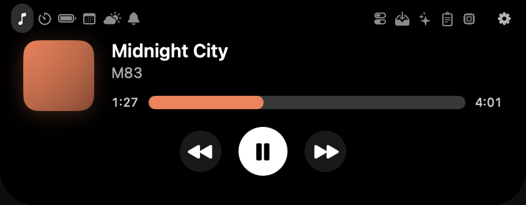
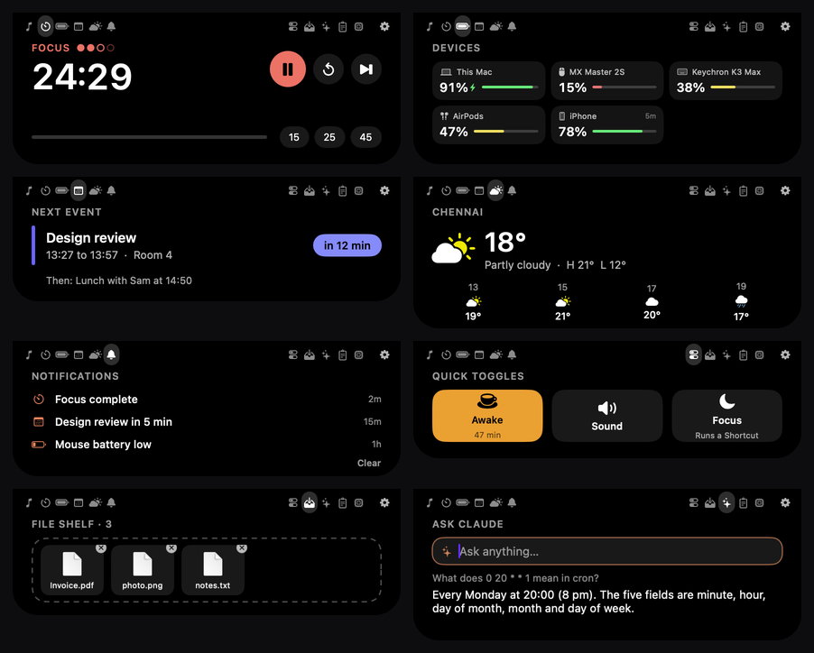

<h1 align="center">Nimbus</h1>

<p align="center">
  A free, open-source dynamic island for the MacBook notch.<br>
  Now playing, Pomodoro, calendar, batteries (iPhone included), weather and more, right where the notch is.
</p>

<p align="center"></p>

Nimbus turns the dead space around your MacBook's notch into something useful. It sits flush with the notch
when idle, shows a live glimpse when something is happening (music playing, a timer running, a meeting about
to start), and opens into a full widget when you hover it.

Built with SwiftUI and AppKit. No account, no tracking, no server of ours.

Developed by [Harshavardanan](https://github.com/harshavardanan).

> **Status: early (v0.1).** It works and is tested on a notched MacBook. It isn't notarized yet, so macOS asks
> you to allow it once. See [Known limitations](#known-limitations).

## Widgets

<p align="center"></p>

| Widget | What it does |
|---|---|
| **Now playing** | Apple Music and Spotify. Album art, transport buttons, and a progress bar you can drag to seek. |
| **Pomodoro** | Focus, short break and long break cycles. Drag the time to set it. Shows in the notch while running. |
| **Devices battery** | This Mac, keyboards, mice, trackpads, AirPods, and your iPhone or iPad. Pops out when something is low. |
| **Calendar** | Next event with a countdown. Shows in the notch in the last 15 minutes before it starts. |
| **Weather** | Current conditions and the next hours, from Open-Meteo (no API key). |
| **Notifications** | Banners for Nimbus's own alerts: calendar reminders, finished timers, low batteries. |
| **Quick toggles** | Keep your Mac awake, mute, and run a Focus Shortcut. |
| **File shelf** | Drop files on the notch to park them, drag them out later. |
| **Ask Claude** | Type a question and the answer streams in. Needs your own Anthropic API key. |
| **Clipboard** | The last 3 text items. Drag them into any app, or click to copy again. Off by default. |
| **System stats** | CPU, memory and network speed. Off by default. |

**Using it:** hover the notch to open it. The icons on both sides of the notch switch widgets, and so does a
sideways two-finger swipe. The gear opens Settings.

## Download

**[Download Nimbus for Mac](https://github.com/harshavardanan/Nimbus/releases/latest/download/Nimbus-AppleSilicon.zip)**
(about 1 MB) · [Website](https://harshavardanan.github.io/Nimbus/) · [All releases](https://github.com/harshavardanan/Nimbus/releases)

Needs a Mac with **Apple silicon (M1 or later)** and **macOS 14 (Sonoma) or newer**. A notched MacBook gives the
best result; on other Macs Nimbus draws a small pill at the top centre instead.

## Install (no coding needed)

1. **Open the zip** you downloaded (double-click it in your Downloads folder).
2. **Drag Nimbus into your Applications folder**, then double-click it. macOS will say it can't verify the
   app. Click **Done**.
3. **Allow it once.** Open **Apple menu → System Settings → Privacy & Security**, scroll down, and click
   **Open Anyway** next to "Nimbus was blocked". Enter your password.
4. **Double-click Nimbus again** and click **Open**.

That's all. Nimbus has no Dock icon: look for its small icon at the top right of your menu bar, and move your
mouse over the notch. It welcomes you the first time.

> **Why the warning?** Apple charges developers $99 a year to register apps, and Nimbus is a free open-source
> project that hasn't done that yet. The whole source is here for anyone to read. If step 3 doesn't show
> "Open Anyway", open the Terminal app, paste `xattr -dr com.apple.quarantine /Applications/Nimbus.app`,
> press Return, and open Nimbus again.

To remove it: choose **Quit** from its menu bar icon, then drag Nimbus from Applications to the Trash.

### Build it yourself (for developers)

You need Apple's command line tools (`xcode-select --install`).

```sh
git clone https://github.com/harshavardanan/Nimbus.git
cd Nimbus
./scripts/run.sh release
```

That builds `build/Nimbus.app`, signs it on your Mac and launches it (about a minute). `./scripts/package.sh`
makes the zip that is published on the Releases page.

macOS asks for permission the first time a feature needs it:

| Feature | Permission | Why |
|---|---|---|
| Now playing | Automation (Music, Spotify) | To read what's playing and send play, pause and seek |
| Calendar | Calendars | To read your next event |
| iPhone link | Local network | So your phone can reach your Mac |
| Quick toggles (mute) | none | |

## Make it yours

Open **Settings** (the gear in the island, or the menu bar icon).

- **Look:** four themes (Obsidian, Glass, Aurora, Paper), solid, gradient, glass or album-art backgrounds, text
  and accent colours, borders and shadow.
- **Size:** the closed notch, the compact and open sizes, corner radius, position, and which display it uses.
- **Motion:** five open and close animations (Classic, Drop, Pop, Elastic, Dissolve), spring tuning, and hover
  delays. A Replay button shows each one. Reduce Motion is respected.
- **Widgets:** switch each widget on or off. Turning one off stops it completely.
- **Presets:** export your whole look as a JSON file, and import one.

## iPhone and iPad

Apple offers no way to read an iPhone's battery from a Mac, so Nimbus uses Shortcuts. In Settings, switch on
**Let my devices connect to this Mac** and click **Create iPhone shortcuts**. Nimbus builds five Shortcuts with
your Mac's address and a private token inside. Add them to your iPhone or iPad and run **Nimbus Sync**: the
battery appears in the island at once, over your Wi-Fi, with no server or account.

The same link lets your phone start a Pomodoro on your Mac, show a phone timer in the notch, or send a message
to it. Full guide, safety notes and an iCloud-based fallback: **[docs/iphone-sync.md](docs/iphone-sync.md)**.

## Privacy

- Nimbus makes network requests only for: **Weather** (the city name, to Open-Meteo) and **Ask Claude** (your
  question, to api.anthropic.com, only when you press Return).
- Your Anthropic API key and the Wi-Fi link's token are stored in the macOS **Keychain**.
- **Clipboard** history stays in memory, ignores items that password managers mark as concealed, and is
  forgotten when you switch the widget off.
- The **Wi-Fi link is off until you switch it on**. When on, it accepts only a short fixed list of requests
  (battery level, timer, Pomodoro controls, a message), each needing the token, at most 60 a minute. It isn't
  encrypted, so use it on networks you trust.
- macOS has no public way to read other apps' notifications, so Nimbus doesn't try. Its Notifications widget
  shows Nimbus's own alerts only.

## Known limitations

- **Not notarized**, so macOS asks you to allow it once (see Install). Apple silicon only for now.
- No widget reordering and no global shortcut yet. (Open at login is in Settings.)
- iPhone and iPad connect through Shortcuts: it needs the same Wi-Fi, can't read charging state, and a phone
  timer only shows if you start it with the **Nimbus Timer** shortcut (iOS doesn't let apps read Clock timers).
- Do Not Disturb has no public switch on macOS, so the Focus toggle runs a Shortcut that you create.
- Now playing works with Apple Music and Spotify only. macOS blocks the media API for other apps.
- Only tested on one machine so far. Please open an issue if something looks wrong on yours.

## Project layout

```
Sources/Nimbus/
  Island/        the window, the notch shape, hover, the open and close animations
  Widgets/       the IslandWidget protocol and registry
  NowPlaying/ Timer/ Devices/ Calendar/ Weather/ Notifications/
  QuickToggles/ Shelf/ Claude/ Clipboard/ SystemStats/    one folder per widget
  Sync/          the Wi-Fi link, the sync folder, and the Shortcut builder
  Settings/      settings model, store and window
Shortcuts/       signed iCloud-based Shortcuts (built by scripts/make_shortcut.py)
Tests/           unit tests
docs/            guides and images
```

## Contributing

Adding a widget is one file plus one line. See [CONTRIBUTING.md](CONTRIBUTING.md).

## Development

```sh
swift build       # compile
swift test        # run the unit tests (needs Xcode 16 or later; see CONTRIBUTING.md)
./scripts/run.sh  # build, bundle, sign and launch
```

Handy environment variables for development (set with `open --env NAME=value build/Nimbus.app`):
`NIMBUS_DEMO=expanded` pins the island open, `NIMBUS_WIDGET=<id>` selects a widget with sample data,
`NIMBUS_ENABLE_ALL=1` shows every widget, `NIMBUS_SETTINGS=1` opens Settings.

## License

MIT. See [LICENSE](LICENSE). Developed by [Harshavardanan](https://github.com/harshavardanan).
